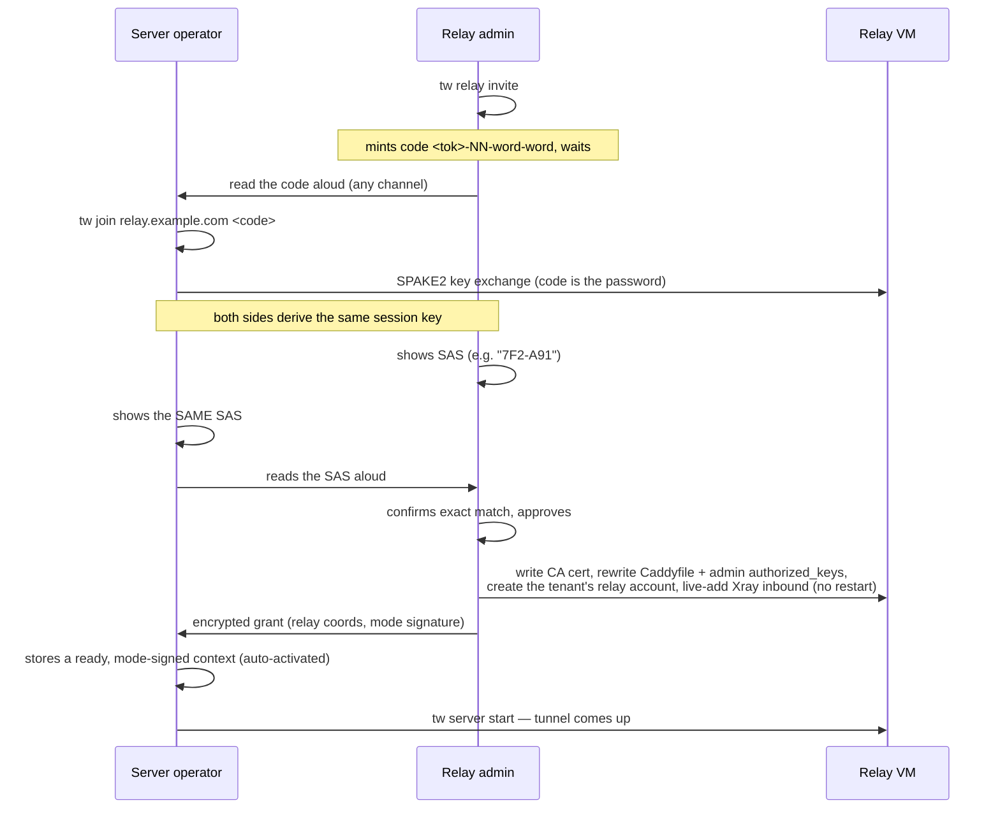

# Tenant Management

One relay can carry many servers. Each server is a **tenant**: it gets its own
path on the relay (`/tw/<server-id>`), its own VLESS UUID and inbound, its own
CA in the mTLS trust pool, and its own reverse-tunnel port. The relay admin
admits and removes tenants at will — live, without restarting the relay's Xray
and without disturbing the other tenants.

The admin's source of truth is the local **registry**
(`<config-dir>/servers/`, one JSON file per tenant). Every enroll and
un-enroll re-renders the *entire* relay configuration from that registry and
rewrites it wholesale on the relay — a stale or corrupted file on the relay
self-heals on the next operation.

## Enrolling a server

Enrollment is a **zero-file invite**: the admin mints a one-time code and
reads it to the server operator over any channel (phone, chat, whatever's
convenient); no request/response files ever change hands.



### On the admin machine

```bash
tw relay invite [--ttl 15m]
```

This mints a one-time invite code — `<tok>-NN-word-word`, from a curated
BIP-39 wordlist — and blocks, waiting for the enrollee. Read the code to the
server operator over **any** channel: it's a [SPAKE2](https://en.wikipedia.org/wiki/Password-authenticated_key_agreement)
password, not a bearer credential, so overhearing it alone doesn't grant
enrollment (see [Security](#security)).

### On the server (the new machine)

```bash
sudo tw join relay.example.com <code> [--name <ctx>]
```

`tw join` works with **no mode configured yet** — it's the single entry point
for both roles, and the issuer's invite decides which one you get. Running it
against a `tw relay invite` code enrolls this machine as a **server** tenant.
Both terminals — the admin's `tw relay invite` and this machine's `tw join` —
now show a short authentication string (SAS), e.g. `7F2-A91`. **Read yours
aloud to the admin**; they approve only on an exact match.

Once approved, `tw join`:

1. **Generates identity** — an Xray UUID, an ed25519 SSH key pair, and a
   per-server CA plus client certificate for the relay's mutual-TLS gate, all
   locally on this machine.
2. **Runs the enrollment** — the admin's side executes the same five steps as
   before (register, build the tenant list, apply relay config, live-add the
   Xray inbound, done); nothing here changed except how the request/response
   travel.
3. **Stores the result** — a new, mode-signed context, named
   `--name` or auto-derived from the relay host. On a fresh machine with no
   active profile it's activated immediately; otherwise switch to it with
   `tw config use-context <name>`.

```bash
tw server start
```

!!! note "Enroll and un-enroll are serialized"
    Both operations render the full relay state from the registry and rewrite
    it wholesale, so they take a per-profile lock. Concurrent runs queue up
    rather than dropping each other's tenants.

## Security

- **The code is a PAKE password, not a bearer credential.** `tw join` and
  `tw relay invite` run [SPAKE2](https://en.wikipedia.org/wiki/Password-authenticated_key_agreement)
  over the code; the relay only ever forwards ciphertext between the two
  sides. Someone who overhears the spoken code still can't complete the
  exchange without also passing the SAS check below.
- **The SAS read-back defeats code theft and MITM.** Both sides derive the
  same short authentication string from the session key; the admin approves
  only when the enrollee reads back an exact match. If a thief redeems the
  invite first, they burn it — the real operator's `tw join` then fails with
  "already used", which is the tell that something is wrong.
- **Invites are single-use, short-lived, and burn on any attempt.** Default
  TTL is 15 minutes (configurable with `--ttl` on `tw relay invite`), and the
  invite is consumed by the *first* redemption attempt — including one with a
  wrong code that reaches the relay — not just a successful one.
- **Private keys never transit.** For server enrollment the SSH key and CA
  are generated locally by `tw join` and only public material crosses the
  wire, same as the old file-based handshake. For client enrollment
  (`tw server user invite`, see [Users](../server/users.md)) it goes
  further: the client generates its own SSH key *and* a certificate signing
  request locally, and the server signs the CSR — the client's private key
  never leaves the client machine at all.

## Same machine? Self-enrollment

When the server you want to enroll **is the admin machine itself** (the
single-operator setup: one person runs relay, server, and client), skip the
file exchange — from the relay context:

```bash
tw relay add-server [<context-name>] [--switch]
```

One command performs the whole handshake in-process: it generates a fresh
server identity (UUID, SSH keypair, CA, client certificate) in memory, runs
the same five enrollment steps as `tw relay invite` / `tw join` (register,
build tenant list, apply relay config, live-add the Xray inbound, done),
signs the new profile's mode with the relay key, and stores the result as a
new context (default name `server-<relay's first DNS label>`). Then:

```bash
tw config use-context server-relay   # or pass --switch above
tw server start
```

Notes:

- The active relay context is never modified, and no `tw_join_*.json` files
  are written.
- The new context is **born mode-signed** — none of the "mode is unsigned"
  warnings that appear mid-way through the file-based handshake.
- If the relay context uses the default dashboard/API ports, the new context
  gets free ones (printed on creation), so both contexts' daemons can run
  side by side on the one machine.
- If storing the context fails after the tenant was enrolled, the enrollment
  is rolled back automatically; the error names the tenant to remove with
  `tw relay un-enroll-server` if even the rollback fails.

## Listing tenants

```bash
tw relay get-servers
```

```
SERVER-ID          PATH                   PORT    ENROLLED           TUNNEL
srv-a1b2c3d4       /tw/srv-a1b2c3d4       20000   2026-07-12T09:41   up
srv-e5f6a7b8       /tw/srv-e5f6a7b8       20001   2026-07-20T18:03   down
```

The table combines the registry with **one live query against the relay**: a
tenant's tunnel is `up` iff the relay currently holds a listener on that
tenant's allocated port (i.e. the server's reverse SSH tunnel is established).
If the relay is unreachable the command **fails hard** rather than showing a
stale table.

## Un-enrolling a server

```bash
tw relay un-enroll-server <server-id> [--yes]
```

This removes the tenant **completely** — configuration and live state:

1. **Block re-auth** — the tenant's relay account is removed: its processes
   are killed, then the account, its `authorized_keys`, its server-id mapping
   and its request socket are deleted, so it cannot re-establish anything.
2. **Sever live VLESS** — the tenant's inbound and routing rules are
   hot-removed from the running Xray, cutting the server transport and all of
   its clients immediately.
3. **Kill the reverse tunnel** — the sshd session still holding the tenant's
   listener port on the relay is terminated.
4. **Clean the config** — Caddyfile re-rendered, validated, gracefully
   reloaded; the tenant's CA cert removed from `/etc/caddy/ca/`; the Xray
   `config.json` persisted.
5. **Forget locally** — the registry entry is removed *last*, so a mid-way
   failure keeps the entry and the command can simply be **re-run** — every
   step is idempotent.

The command shows the target's identity (ID, port, enrollment time) and asks
for confirmation; `--yes` skips the prompt for scripts (the details still
print, so scripted runs log exactly what was removed). Un-enrollment is not a
ban: the same server can re-join later via a fresh `tw relay invite` / `tw
join` exchange.

## Upgrading an existing relay

Relays provisioned before invite-based enrollment shipped keep working for
already-enrolled tenants without any action — but **no invite of either kind
works yet**, including `tw relay invite` for a new server. A pre-upgrade
render never wrote the admin's own `/enroll/<tok>` route into the Caddyfile,
and `tw relay invite` has no other way to become reachable: the exchange is
served over that exact route, so there's no invite that can bootstrap it into
existence. (Same root cause as the tenant side: the enroll port is a second
`permitlisten` on each tenant's `authorized_keys` line — tunnel port plus
20000 — that a pre-upgrade render never wrote either.)

One **full render** fixes both at once, and it has to be triggered by
something that doesn't itself depend on the missing `/enroll` route:

- If no tenant is enrolled yet, run `tw relay add-server` — it enrolls a
  tenant entirely in-process over the admin's own management SSH connection,
  never through the public `/enroll` endpoint, so it isn't blocked by the
  thing it's fixing. Delete the resulting context (`tw config delete-context
  <name>`) or `tw relay un-enroll-server <its-id>` afterwards if you didn't
  actually want a self-enrolled server.
- If a tenant already exists, `tw relay un-enroll-server <server-id>` on any
  one of them works just as well — un-enrollment also renders the relay's
  full state (admin slot included) directly over SSH, not through `/enroll`.

Either one re-renders the Caddyfile and every tenant's `authorized_keys` from
the registry, adding the admin's `/enroll` route and every tenant's enroll
`permitlisten` in the same pass. After that, both `tw relay invite` and
`tw server user invite` work normally. Relays provisioned by this
version of `tw` already have both from the start and need nothing.

## Migrating to per-tenant relay accounts

Older versions put every tenant's key into the relay **admin** account's
`authorized_keys`. That account has passwordless sudo, and OpenSSH's
`restrict` option does not block command execution, so any enrolled server
could run commands as root on the relay. Tenants now get
[their own locked-down accounts](#tenant-accounts-on-the-relay). To move an
existing relay over, run this once from the relay admin context:

```bash
tw relay sync-tenants
```

It installs the tenant request handler and creates one account per
registered server first. Then it updates the admin account's
`authorized_keys`: tw's admin line is replaced, tenant lines are removed, and
every other key (e.g. your own maintenance key) is kept. If it removed tenant
lines, it also ends every other SSH session of the admin account, so a
pre-migration tenant session (which could still run commands) does not
survive. Other admin sessions, such as an open `tw relay ssh`, are closed
too. Once migrated, later syncs leave the admin's sessions alone. The command
is idempotent. Every enroll, un-enroll and **Close Port 22** runs the same
sync, so a relay also migrates the next time you do any of those.

What happens to the servers:

- **Servers running this `tw` version** have the admin account's name stored
  as their relay SSH user. When the relay rejects their key for that user,
  they retry once with their own tenant account. If that works, they save it
  to `server.relay_ssh_user`. The reverse tunnel reconnects on its own, and
  no action is needed on the server.
- **Servers running an older `tw`** lose their reverse tunnel after the sync:
  their key is gone from the admin account and they don't know about tenant
  accounts. Upgrade `tw` on those servers. After that they fall back to
  their tenant account automatically.
- **A new server on a relay that has not been synced** can bring up its
  tunnel, but adding or removing users on the relay fails with a message
  that tells the relay admin to run `tw relay sync-tenants`.

!!! warning "The sync cannot undo a past compromise"
    Under the old design any tenant could become root on the relay. If a
    relay ever hosted a tenant you do not fully trust, assume it may be
    compromised: rebuild it (re-provision, or a fresh VM with the install
    script), rotate the relay's SSH host key and the admin SSH key, and
    re-enroll the servers so they get fresh CAs.

The relay needs `python3`, because the handler runs on it. Ubuntu cloud
images ship it, and the manual install script installs it. The sync stops
with an error if it is missing.

## Tenant accounts on the relay

Each enrolled server logs in to the relay as its own Unix account: `twt-`
followed by 24 hex characters derived from the server-id (the start of its
SHA-256 hash). Both sides can derive the name from the server-id. The relay
admin's enrollment creates the account and tells the server its name.

| Relay path | Purpose |
| ---------- | ------- |
| `/var/lib/tw/tenants/<account>/.ssh/authorized_keys` | The tenant's single key line, root-owned |
| `/etc/tw/tenants/<account>` | Maps the account to its server-id (root, `0600`) |
| `/run/tw/tenant/<account>.sock` | Request socket, owned by the account, `0600` |
| `/usr/local/lib/tw/tw-tenant-request` | The only program a tenant session runs |
| `/usr/local/lib/tw/tw-tenant-handler` | Root-side handler, started per connection |
| `/etc/systemd/system/tw-tenant@.socket`, `tw-tenant@.service` | Socket activation, one `tw-tenant@<account>.socket` per tenant |
| `/etc/ssh/sshd_config.d/98-tw-tenants.conf` | `Match User twt-*` block |

A tenant's session can only do one thing. Its key line forces
`command="/usr/local/lib/tw/tw-tenant-request"`, and the sshd drop-in repeats
this as `ForceCommand` for every `twt-*` account. So any exec, shell or
subsystem request runs `tw-tenant-request`, which ignores the requested
command. It reads one request line from stdin (`add <uuid>`, `remove <uuid>`
or `list`) and passes it to the account's own socket. systemd starts
`tw-tenant-handler` as root for that connection. The handler identifies the
tenant only from the socket path and the peer's uid, then edits only that
tenant's `vless-in-<server-id>` inbound in the relay Xray config. It applies
the change live through the Xray API and never restarts Xray. If the live
apply fails, the change stays saved in the config and takes effect at the
next Xray restart, and `tw` shows a warning. It accepts only canonical
lowercase UUIDs, holds at most 1000 clients per tenant inbound, and refuses
to remove the server's own UUID. The handler runs under a systemd sandbox
that leaves it write access to `/usr/local/etc/xray` only. It and the admin
take the same lock around every edit of the Xray config.

The drop-in also sets `AllowTcpForwarding remote`, `PermitTTY no` and turns
off agent, X11, stream-local and tunnel forwarding for `twt-*` accounts. The
sync runs `sshd -t` before reloading sshd. If sshd rejects the config, the
sync removes the drop-in again and fails. It also checks with `sshd -T` that
the `Match` block is in effect for the tenant accounts, and fails if it is
not.

## Dashboard equivalents

The admin dashboard's **Servers** page mirrors the read side of this:

- the enrolled-servers table with the same columns (Server ID, Path, Port,
  Enrolled, Tunnel), with the tunnel state queried live from the relay;
- per-row **un-enroll**, with the same complete-removal semantics.

Enrollment itself (`tw relay invite`, `tw server user invite`) is
CLI-only for now — the human-in-the-loop SAS confirmation doesn't yet have a
dashboard equivalent.

## Isolation properties

What a tenant *gets*:

| Per tenant | Enforced by |
| ---------- | ----------- |
| Own path `/tw/<server-id>` with its own Caddy handle block | Caddyfile, rendered per tenant |
| Own CA in the mTLS trust pool (`/etc/caddy/ca/<id>.crt`) | Caddy `client_auth verify_if_given` + per-tenant CN match |
| Own VLESS UUID and Xray inbound | Relay Xray config |
| Own reverse-tunnel port (allocated at enrollment) | `permitlisten` in its `authorized_keys` line |
| Own Unix account `twt-<24 hex>` without sudo | Created by the tenant sync on enroll |

What a tenant *can* do on the relay: publish its two reverse forwards, and
add, remove or list client UUIDs on its own Xray inbound through the
[tenant request handler](#tenant-accounts-on-the-relay).

What a tenant *cannot* do on the relay:

- **No shell, no commands** — every session runs the forced
  `tw-tenant-request` (`command=` on its key line and `ForceCommand` in the
  sshd drop-in), whatever the tenant asks for. The account has no sudo, no
  TTY, and no agent or X11 forwarding. (`restrict` alone would not do this:
  it does not block exec or shell requests.)
- **No touching other tenants' inbounds** — the handler derives the inbound
  from the account the kernel reports for the socket peer, never from the
  request.
- **No listening on other tenants' ports** — `permitlisten` pins its reverse
  forwards to its own two allocated ports (tunnel + enroll) only.
- **No reaching relay-internal services** — local (`-L`) forwarding is pinned
  by `permitopen` to a dead sentinel port, so a tenant cannot dial the relay's
  Xray management API or any other loopback service.
- **No direct SSH from the internet** — tenant keys are always pinned
  `from="127.0.0.1"` (tunnel-only), even on `--ssh-open` relays.
- **No reading anyone's traffic** — all streams through the relay are
  end-to-end SSH-encrypted between client and server; the relay (and therefore
  the admin) only ever sees ciphertext.

The exact `authorized_keys` lines behind these guarantees are dissected on
[SSH access](ssh-access.md).

## Troubleshooting tenant accounts

**`relay tenant request "add" failed: ... if the relay predates per-tenant
accounts, its admin must run 'tw relay sync-tenants'`** — the relay has no
tenant handler yet. Run `tw relay sync-tenants` from the admin context.

**`relay refused "add" request: <reason>`** — the handler ran and refused
the request. Common reasons:

- `this account is not registered as a tenant on the relay`, or
  `tenant registration does not match this account`: the server-id mapping
  is missing or wrong. Run `tw relay sync-tenants`.
- `inbound vless-in-<id> not found on the relay`: the relay Xray config
  lacks the tenant's inbound, for example after an install-script re-run.
  Re-enroll the server.
- `tenant request channel unavailable on the relay`: the account's socket
  is not listening.
- `internal error on the relay (see journalctl -u 'tw-tenant@*')`: check the
  journal on the relay.

On the relay (`tw relay ssh`):

```bash
sudo ls /etc/tw/tenants/                             # tenant account names
systemctl status 'tw-tenant@<account>.socket'        # one socket per tenant account
sudo journalctl -u 'tw-tenant@*' --since -1h         # handler log: peer, request, reply
sudo sshd -T -C user=<account>,host=localhost,addr=127.0.0.1 | grep -i forcecommand
```

**A server's tunnel stopped after the sync** — the server most likely runs
a `tw` version without the tenant fallback. Upgrade `tw` on the server. Its log should then show `relay ssh
user migrated to the server's tenant account`.

**`tw relay sync-tenants` fails** — the error carries the relay-side
output:

- `python3 is required on the relay`: install it (`apt-get install -y
  python3`) and rerun.
- `account twt-... exists but is not a tw tenant account`: a non-tw user
  already has that name. Remove or rename it.
- `sshd rejected its config with the tenant drop-in`: fix the reported
  sshd error and rerun.
- The `Match User twt-*` block is not in effect for the tenant accounts:
  check the rest of the sshd configuration with the `sshd -T` command below,
  fix what keeps the block from applying, and rerun.
